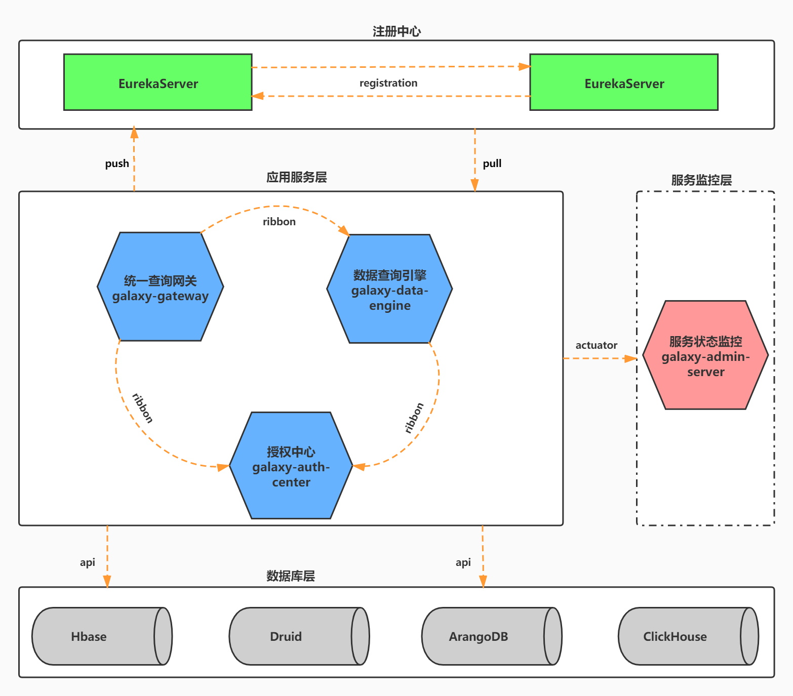

#银河数据服务平台
## Introduction
统一的接口支持流式、批量作业，提供交互式SQL分析和例行调度，让您更方便编写和提交ETL程序，高效执行大数据计算程序，让大数据处理变得如此简单。
## Technology stack
**Spring Boot 2.2.2.RELEASE**

**Spring Cloud Hoxton.SR1**

**Spring Cloud Eureka**

**Spring Cloud Gateway**
## 系统架构图
