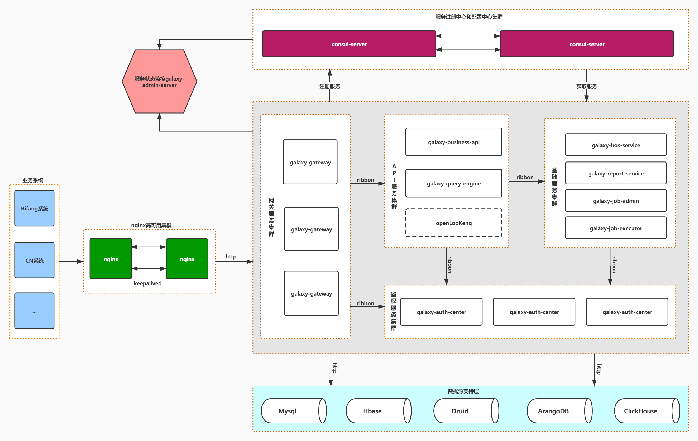

# 银河数据服务平台

## Introduction
统一的接口支持流式、批量作业，提供交互式SQL分析和例行调度，让您更方便编写和提交ETL程序，高效执行大数据计算程序，让大数据处理变得如此简单。
## Technology stack
**Spring Boot 2.0.2.RELEASE** https://docs.spring.io/spring-boot/docs/2.2.2.RELEASE/reference/html/index.html

**Spring Cloud Hoxton.SR1** https://spring.io/blog/2019/12/21/spring-cloud-hoxton-service-release-1-sr1-is-available

**Spring Cloud Eureka** https://docs.spring.io/spring-cloud-netflix/docs/2.2.4.RELEASE/reference/html/

**Spring Cloud Gateway** https://docs.spring.io/spring-cloud-gateway/docs/2.2.4.RELEASE/reference/html/

**Spring Boot Admin 2.3.0** https://codecentric.github.io/spring-boot-admin/2.3.0/
## 系统架构图

## 项目启动顺序

1.  **[galaxy-eureka-server](https://git.mesalab.cn/galaxy/galaxy-data-platform/-/tree/master/galaxy-eureka-server)** 优先启动注册中心,各服务启动时会向注册中心提交服务和拉取服务列表

2.  **[galaxy-auth-center](https://git.mesalab.cn/galaxy/galaxy-data-platform/-/tree/master/galaxy-auth-center)** 启动认证中心,此模块主要是做接口鉴权和ArangoDB登录等

3.  **[galaxy-data-engine](https://git.mesalab.cn/galaxy/galaxy-data-platform/-/tree/master/galaxy-data-engine)** 启动数据引擎服务,主要业务逻辑和服务接口在这个模块中实现

4.  **[galaxy-gateway](https://git.mesalab.cn/galaxy/galaxy-data-platform/-/tree/master/galaxy-gateway) [可选]** 网关服务在Dev环境可以不启动,直接调用对应模块的IP:PORT即可测试

5.  **[galaxy-admin-server](https://git.mesalab.cn/galaxy/galaxy-data-platform/-/tree/master/galaxy-admin-server) [可选]** 监控服务主在Dev环境也是可选的,如果想查看内存和线程使用情况,可以启动这个项目

## 启动注意事项
idea下启动项目需要设置一个启动参数,具体操作如下:
Edit Configuration > Environment > Working directory: **$MODULE_DIR$**

